# Plan Perbaikan Komprehensif UI/UX: Standarisasi Desain Sistem shadcn/ui & beUI.dev

Dokumen ini memuat analisis mendalam mengenai inkonsistensi tipografi, padding, dan komponen antarmuka yang ada saat ini, serta rencana sistematis untuk menyelaraskan seluruh tampilan HeuriLab dengan standar resmi **shadcn/ui** dan **beUI.dev**.

---

## 1. Analisis Akar Masalah (Root-Cause Analysis)

### A. Tipografi Acak & Mikro-Font (Inkonsistensi Font Size)

- **Masalah Saat Ini**:
  - Ditemukan banyak font size hardcoded mikro yang tidak terbaca dan tidak standar di `styles.css`: `font-size: 9px;`, `font-size: 10px;`, `font-size: 10.5px;`, `font-size: 11px;`, `font-size: 12.5px;`, `font-size: 15px;`, dan `font-size: 27px;`.
  - Teks pada tabel (_trace_ & _leaderboard_) berukuran `9px - 10px`, membuat mata lelah dan terlihat kuno/tidak profesional.
  - Hierarki judul terputus: Label input kecil dan tipis, sementara tombol _"Jalankan"_ terlalu besar tanpa transisi skala yang harmonis.
- **Standar shadcn/ui & beUI.dev**:
  - Berpatokan pada skala **Tailwind Typography Scale** berbasis 4px (rem):
    - `text-xs` (12px / 0.75rem, leading 16px): Hanya untuk _badges, caption keterangan sekunder, overline_. Tidak boleh ada font di bawah 12px!
    - `text-sm` (14px / 0.875rem, leading 20px): **Ukuran default utama** untuk form inputs, dropdown select, button standar, dan sel tabel.
    - `text-base` (16px / 1rem, leading 24px): Sub-heading kartu, teks dialog modal.
    - `text-lg` (18px / 1.125rem, leading 28px): Judul kartu (_card title_), header panel.
    - `text-xl` (20px / 1.25rem, leading 28px): Judul halaman / sub-view.
    - `text-2xl` - `text-3xl` (24px - 30px): Judul brand & angka metrik utama dengan `font-variant-numeric: tabular-nums`.

---

### B. Komponen `<Select>` Rusak & Mepet (Bug Visual & UX Dropdown)

- **Masalah Saat Ini**:
  - Pada screenshot: Teks label dan deskripsi opsi dropdown bertabrakan tanpa jeda atau baris baru:
    `Nearest NeighborPilih titik terdekat berikutnya` dan `Nearest InsertionSisipkan node dengan delta terendah`.
  - Hal ini terjadi karena `.custom-select-item-content` memakai `display: flex; align-items: center; gap: 8px;` dalam satu baris horizontal tanpa `flex-direction: column`, sehingga di ruang sempit label dan deskripsi bersambung seperti satu kata bersambung.
  - Ukuran popover terlalu sempit, item terlalu mepet (`padding: 7px 10px;`), trigger tidak memiliki tinggi standar (`h-10` / 40px), dan transisinya kasar.
- **Standar shadcn/ui Asli (`components/ui/select.tsx`)**:
  - **SelectTrigger**:
    - Tinggi presisi `h-10` (40px) atau `h-9` (36px).
    - `padding: 0.5rem 0.75rem` (`px-3 py-2`), `font-size: 0.875rem` (14px).
    - Border `border-slate-200`, background `bg-white`, rounded `rounded-md` (8px).
    - Fokus jelas dengan `ring-2 ring-teal-600/20 border-teal-600`.
  - **SelectContent (Popover)**:
    - `p-1.5`, background `bg-white`, border `border-slate-200`, shadow lembut `shadow-lg`, rounded `rounded-lg`.
    - Animasi beUI spring: `data-[state=open]:animate-in fade-in-0 zoom-in-95`.
  - **SelectItem**:
    - Kontainer vertikal:
      ```tsx
      <div className="flex flex-col items-start text-left gap-0.5 flex-1 min-w-0">
        <span className="text-sm font-medium text-slate-900 leading-snug">{label}</span>
        {description && (
          <span className="text-xs text-slate-500 leading-normal line-clamp-2">{description}</span>
        )}
      </div>
      ```
    - Checkmark diletakkan rapi di sebelah kanan (`ml-3 shrink-0 text-teal-600`).
    - Padding item luas dan lega: `py-2.5 px-3`.

---

### C. Padding & Spacing Tidak Konsisten (Arbitrary Padding)

- **Masalah Saat Ini**:
  - Angka-angka ganjil non-sistemik: `padding: 16px 17px;`, `10px 9px;`, `12px 9px;`, `5px 13px;`, `5px 11px;`, `7px 10px;`.
  - Spasi antar elemen di panel samping tidak seimbang: input parameter mepet satu sama lain, namun footer tombol memiliki jarak yang tidak proporsional.
- **Standar Skala Spasi (Grid 4px/8px)**:
  - Form Fields & Inputs: `p-2.5 px-3.5` (tinggi 40px, teks 14px).
  - Cards & Panels: `p-5` (20px) atau `p-6` (24px) dengan radius seragam `rounded-xl` (12px-14px).
  - Table: Header `px-4 py-3`, baris sel `px-4 py-3.5` (tinggi baris ~52px untuk keterbacaan optimal).
  - Dialog / Modal: Header `px-6 py-4`, Content `p-6`, Footer `px-6 py-4`.

---

### D. Tampilan Halaman Report & Panel Kanan (Layout & Whitespace)

- **Masalah Saat Ini**:
  - Di halaman Report, terdapat ruang putih kosong raksasa di bawah tabel leaderboard yang membuat halaman terlihat belum selesai.
  - Tombol-tombol di header laporan (_Ekspor JSON_, _Ekspor CSV_, _Bersihkan Riwayat_) memakai font dan padding yang berbeda-beda.
  - Kartu parameter di ControlHub tidak memiliki visual grouping yang rapi (Tabu tenure & annealing parameter melayang tanpa kontainer card).
- **Perbaikan**:
  - Menata tabel leaderboard dengan layout kartu (_card wrapper_) bertepi halus, header beraksen slate-50, baris bergaris tipis slate-100, hover effect lembut, dan ringkasan metrik statistik di samping/bawahnya.
  - Membungkus grup parameter algoritma dalam kartu berarsitektur shadcn (`rounded-xl border border-slate-200/80 bg-slate-50/50 p-4 space-y-3.5`).

---

## 2. Rencana Implementasi Bertahap

```mermaid
flowchart TD
    A["1. Standarisasi Token CSS & Typography Scale (styles.css)"] --> B["2. Refactor shadcn <Select> Component (select.tsx)"]
    B --> C["3. Restrukturisasi ControlHub (Form & Parameter Layout)"]
    C --> D["4. Revamp ReportView (Leaderboard, Convergence, Matrix)"]
    D --> E["5. Verifikasi & Polishing (bun check + Browser Test)"]
```



### Tahap 1: Standarisasi Token CSS & Skala Tipografi (`src/design-system/styles.css`)

1. **Definisikan Token Tipografi Sistemik**:
   - Gantikan semua `9px`, `10px`, `11px` dengan kelas/variabel skala Tailwind:
     - `12px` (`var(--font-xs)`), `14px` (`var(--font-sm)`), `16px` (`var(--font-base)`), `18px` (`var(--font-lg)`), `20px` (`var(--font-xl)`), `24px` (`var(--font-2xl)`).
2. **Definisikan Skala Spasi Sistemik**:
   - `4px`, `8px`, `12px`, `16px`, `20px`, `24px`, `32px`.
   - Hilangkan padding ganjil (`17px`, `9px`, `13px`, dll).
3. **Standarisasi Kontrol Form & Button**:
   - Tinggi seragam 38px–40px untuk semua select trigger dan text input.
   - Border radius konsisten: `rounded-lg` (8px) untuk kontrol, `rounded-xl` (12px) untuk kartu, `rounded-2xl` (16px) untuk modal.

### Tahap 2: Refactor Penuh Komponen `<Select>` (`src/components/ui/select.tsx`)

1. **Pemisahan Blok Label dan Deskripsi**:
   - Ubah struktur item menjadi `flex-col` agar label judul berada di atas, dan teks deskripsi berada di bawah dengan warna `text-slate-500` dan font `text-xs`.
   - Berikan `margin-bottom: 2px` pada label judul dengan `font-weight: 500; font-size: 14px;`.
2. **Layout & Dimensi Popover**:
   - Lebar popover diselaraskan dengan trigger (`min-w-[100%]`), dengan `max-height: 280px` dan padding `p-1.5`.
   - Item dropdown diberikan padding lega `py-2.5 px-3` dengan transisi hover `hover:bg-slate-100/80`.
   - Posisi checkmark di kanan terisolasi (`ml-auto shrink-0`).

### Tahap 3: Pembenahan Panel Kontrol (`src/features/experiment/ControlHub.tsx`)

1. **Grouping Parameter Algoritma**:
   - Bungkus parameter Tabu Search (Tenure, Aspiration info) dalam sub-kartu berlatar `bg-slate-50/70 border border-slate-200/80 rounded-xl p-4`.
   - Bungkus parameter Simulated Annealing (Suhu T₀, Cooling α, Iterasi/suhu, Seed) dengan format grid 2 kolom yang presisi dan rapi.
2. **Standarisasi Label Form**:
   - Label form menggunakan `text-xs font-semibold text-slate-700 uppercase tracking-wider mb-1.5 block`.
   - Input angka (number inputs) memakai `h-10 text-sm font-mono px-3 border border-slate-300 rounded-lg`.
3. **Tombol Eksekusi (_Call to Action_)**:
   - Tombol _"Jalankan Eksperimen"_ dirapikan dengan tinggi `h-11`, font `text-sm font-semibold`, warna emerald/teal solid dengan shadow elegan khas beUI.
   - Tombol _"Ulangi dengan SA/TS"_ dirapikan menjadi secondary outline button yang serasi.

### Tahap 4: Pembenahan Tampilan Laporan (`src/features/report/ReportView.tsx`)

1. **Leaderboard Table Revamp**:
   - Bungkus tabel dalam kontainer card terstruktur (`bg-white rounded-xl border border-slate-200 overflow-hidden shadow-xs`).
   - Header tabel: `bg-slate-50/80 text-xs font-semibold uppercase tracking-wider text-slate-600 px-4 py-3.5`.
   - Baris data: `text-sm text-slate-800 px-4 py-3.5 border-b border-slate-100 hover:bg-slate-50/50`.
   - Mengisi ruang kosong bawah dengan ringkasan cepat: kartu _Best Overall Tour_, _Average Improvement_, dan _Total Runs Executed_.
2. **Analisis Konvergensi**:
   - Standarisasi ukuran teks sumbu chart SVG dan legenda.
   - Run chips bar dan switcher pembanding dibuat rapi berukuran `text-sm`.
3. **Matriks Jarak**:
   - Header matriks berukuran `text-xs font-bold font-mono px-3 py-2.5`.
   - Angka sel matriks berukuran `text-xs font-mono px-3 py-2.5 text-center`.
   - Banner formula perhitungan Euclidean berukuran `text-sm` dengan badge koordinat yang kontras dan bersih.

### Tahap 5: Verifikasi & Uji Kualitas

1. **Lint & Test**: Jalankan `bun run check` (`oxfmt`, `oxlint`, `bun test`, `vite build`) dengan target 0 error dan 0 warning.
2. **Browser Subagent Testing**: Uji langsung di browser, verifikasi interaksi select (tidak mepet lagi), cek skala font, dan ambil screenshot pembuktian.

---

## 3. Komparasi Sebelum vs Sesudah (Antisipasi Perubahan)

| Aspek                        | Kondisi Saat Ini                              | Desain Sistem Baru (shadcn + beUI)                                         |
| ---------------------------- | --------------------------------------------- | -------------------------------------------------------------------------- |
| **Font Ukuran Kecil**        | 9px – 11px (tidak terbaca, kabur)             | Minimum 12px (`text-xs` badge/caption), 14px (`text-sm` body/inputs/table) |
| **Select Dropdown**          | Label & deskripsi mepet bersambung horizontal | Stack vertikal rapi (`flex-col`), label 14px medium, deskripsi 12px muted  |
| **Select Trigger & Popover** | Tinggi tidak konsisten, padding 7px           | Tinggi `h-10` (40px), popover `p-1.5`, item `py-2.5 px-3`, shadow halus    |
| **Form Parameter Panel**     | Parameter tersebar tanpa grouping jelas       | Kartu sub-group bergaris halus `rounded-xl bg-slate-50/60 p-4`             |
| **Tabel Leaderboard**        | Teks 10px-11px, void kosong besar di bawah    | Card table modern, sel 14px, ringkasan statistik komparasi di bawah tabel  |
| **Spasi & Padding**          | Arbitrary (`17px`, `9px`, `13px`)             | Strict 4px/8px scale (`px-3 py-2`, `p-4`, `p-5`, `p-6`)                    |

---

Apakah Anda setuju dengan rencana standarisasi desain sistem dan perbaikan UI/UX ini agar dapat segera diimplementasikan?
